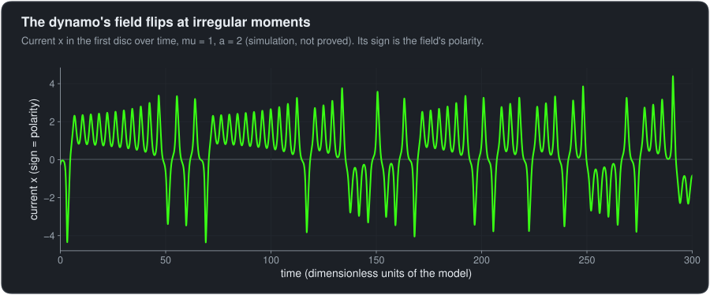
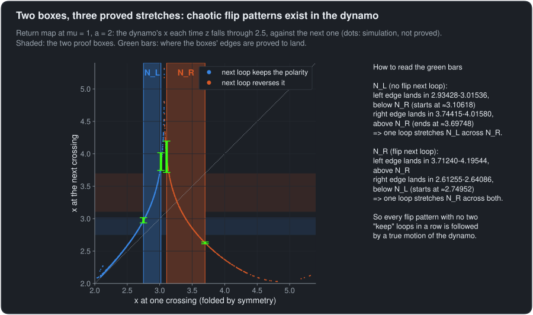
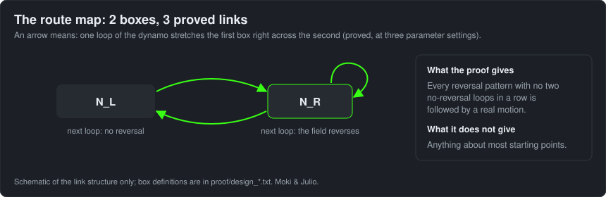
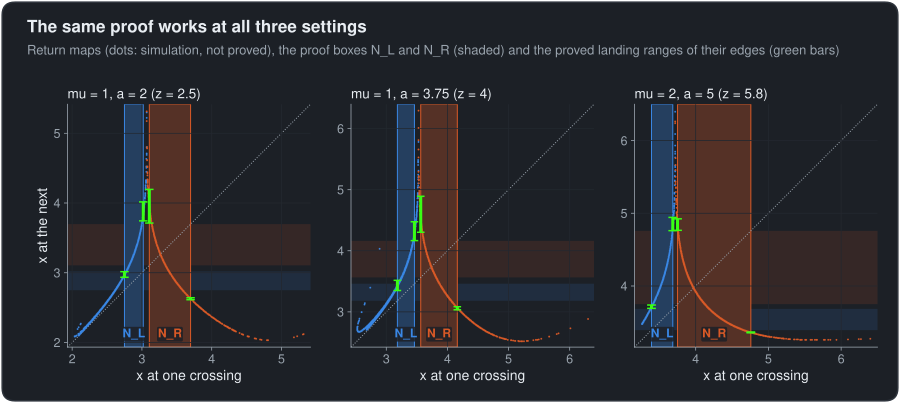

# Rikitake's dynamo is chaotic: a computer-assisted proof

**Rikitake's two-disc dynamo, the simplest mechanical model of a planet's magnetic field flipping and called chaotic since 1980, is proved to have chaotic motions at three parameter settings.**

[](https://doi.org/10.5281/zenodo.23041182)  [](https://github.com/Hashirama1337s)

Moki & Julio · 2026 · version 1.1.1

**Read** [TECHNICAL.md](TECHNICAL.md) · **Re-run** `bash reproduce.sh` · **Check** [independent/SPEC.md](independent/SPEC.md)

## In plain words

A planet's magnetic field can flip, north becoming south. In 1958 Tsuneji Rikitake proposed the simplest mechanical
model of such flipping: two spinning copper discs, each driving current through the other's coil. Three
equations describe it, and in simulations its polarity reverses at irregular, apparently random moments.



*The current x in the first disc (mu = 1, a = 2; a simulation, not proved). Its sign is the field's polarity, so each crossing of the zero line is a reversal, and the reversals come at irregular moments. The theorem proves that motions with chaotic flip patterns exist, not that this simulated run is one of them.*

Since Ito's numerical study of 1980 the model has been called chaotic, and it is used as a stock chaotic system in
hundreds of papers. Its relatives have been proved chaotic: the Lorenz equations, and the Rössler equations (in 1997),
among others. As far as we could find, Rikitake's dynamo never was. This repository proves it for three parameter settings.

 **The idea in one picture.** **Kneading dough.** A baker stretches the dough long, lays it back across itself and stretches
it again. Crumbs that start side by side can be sent along completely different routes. Here the "dough" is the set of possible states of the dynamo, and one
loop of its motion does the stretching. We picked two small, thin boxes of states: one whose next loop brings **no**
reversal, one whose next loop **does** reverse. We proved that one loop stretches each box right across the boxes it
leads to, overhanging both ends; the "reverse" box is stretched across both.

Once every link is proved, any route through the links is followed by a real motion. **Where the picture breaks.** A baker
mixes all the dough, but we prove the stretching only for these two thin boxes. The theorem says nothing about most
starting points, or about what a typical simulation settles into. It also says nothing about how fast nearby states separate (no Lyapunov exponents).

"Proved" here means this. Every calculation returns a range that is guaranteed to contain the true value, with every
rounding error counted. Two programs, written separately, check every case. Both pass all three, and both reject a
deliberately broken box. Version 1.1 fixed a slip in one bound shared by both programs, and made checker B run CAPD
in one process per strip (see [TECHNICAL.md](TECHNICAL.md)); the results did not change.

## At a glance

*The exact claims, for specialists. Terms are explained in "How it works" and "Words you will meet".*

- **Theorem.** For (mu, a) ∈ {(1, 2), (1, 3.75), (2, 5)} (exact IEEE doubles in `proof/design_*.txt`), let Q be the
  first-return map of the Rikitake flow to z = c (c = 2.5, 4.0, 5.8; crossings with z decreasing), folded by the symmetry
  (x, y, z) -> (-x, -y, z). There are disjoint compact N_L, N_R in that plane with Q: N_L ⇒ N_R, N_R ⇒ N_L, N_R ⇒ N_R
  (Zgliczyński–Gidea covering relations); orbits through N_L return without a reversal, orbits through N_R with one.
- **Consequences.** Every pattern with no two consecutive non-reversals is realised; infinitely many periodic orbits; a
  compact invariant set on which Q is semi-conjugate to the golden-mean shift, so h_top ≥ log((1+√5)/2) ≈ 0.481 per
  return.
- **Checkers.** Checker A ([`proof/check.cpp`](proof/check.cpp), CAPD, order 20): 62,041 / 352,843 / 529,398 pieces,
  about 9 / 55 / 72 min on one core, all VERIFIED. Checker B ([`independent/`](independent/), a generic verifier written
  from [`independent/SPEC.md`](independent/SPEC.md) only): 44,166 / 164,809 / 323,590 pieces, all PASS, with an exact
  coverage audit (PASS).
- **Controls.** CAPD's proof of the Rössler horseshoe reproduces; a design with one edge moved is rejected by both.
- **Correction (v1.1).** Both v1.0 checkers evaluated one Lagrange remainder over the wrong interval (rigorous here
  only because the expansion point lies in the interval by construction). v1.0 checker B also ran several CAPD threads
  in one process, which CAPD does not guarantee to be safe; v1.1 uses one process per strip. Both fixed in v1.1; every
  result regenerated, nothing changed. Details: [TECHNICAL.md](TECHNICAL.md).



*Each dot compares the dynamo's state at one pass through the plane z = 2.5 with the next pass (mu = 1, a = 2; simulation, not proved). Blue: the next loop keeps the polarity; orange: it reverses it. Shaded: the proof boxes N_L and N_R. Green bars: where the boxes' edges are proved to land after one loop, every rounding error counted. N_L is stretched right across N_R, and N_R across both boxes, so every flip pattern with no two "keep" loops in a row is followed by a true motion.*

Full technical record: [TECHNICAL.md](TECHNICAL.md).

## What we do not claim

- That almost every orbit is chaotic, or that the attractor seen in simulations is exactly this invariant set.
- Anything at parameter values other than the three proved.
- Version 1.0 of both checkers shared a slip in one bound (the Lagrange remainder of the chart polynomial). It did not
  bite here, but as written the step was not rigorous in general. v1.1 fixes it, regenerates every result and records
  the slip in the "Correction (v1.1)" section of [TECHNICAL.md](TECHNICAL.md).
- Both checkers use the CAPD library (our note; the same limit is stated in the laser-chaos repository), so a bug
  inside CAPD would affect both. The v1.0 slip shows the same risk from another side: two independently written
  checkers can still share a mistake.
- v1.0 checker B ran several CAPD threads in one process, which CAPD does not guarantee to be safe; v1.1 runs one
  process per strip.

## How it works

### The idea

The dynamo has no outside push, so there is no strobe to sample it with. Instead we take a snapshot each time the third
variable z falls through a fixed value c. The rule that takes one snapshot to the next is the **return map** Q. Because
a field and its exact reverse behave alike, Q treats them as the same state and records only whether the polarity
flipped on the way.

The route map has two boxes: N_L (the next loop does **not** reverse) and N_R (the next loop **does**).



There is no arrow from N_L to itself. So the theorem reads: for **any** endless sequence of "reverse / don't reverse"
with no two "don't" in a row, there is an exact solution of the equations whose loops follow that sequence. Repeating
sequences give repeating motions, so there are infinitely many periodic orbits.

### A worked example

The equations are x' = -mu x + y z, y' = -mu y + (z - a) x, z' = 1 - x y. Polarity reverses when x and y change sign
together. The three proved settings are (mu, a) = (1, 2), (1, 3.75) and (2, 5), with snapshot levels c = 2.5, 4.0 and
5.8. The parameters mu and a are numbers in the equations that set how the discs and coils behave.

**A good ruler.** On the snapshot plane, the simulated motion lies close to a thin curve. We fit a fixed polynomial to
that curve once and measure each point by u (the x-coordinate along the curve) and s (the height above or below it). Each box is a stretch of
u with |s| below a small width w.

**A worked example, setting (1, 2).** N_L runs from u ≈ 2.74952 to 3.01882 and N_R from u ≈ 3.10618 to 3.69748, with
w = 0.01. Checker A proved where the edges of N_L land after one loop:

| edge of N_L | lands somewhere in | must land | holds? |
|---|---|---|---|
| left edge (u = l0) | [2.93428, 3.01536] | below the start of N_R (3.10618) | yes |
| right edge (u = l1) | [3.74415, 4.01580] | above the end of N_R (3.69748) | yes |

So the image of N_L reaches past both ends of N_R: N_L ⇒ N_R. The edges of N_R land above 3.69748 and below 2.74952, so
its image reaches across both boxes. Each check also needs the image to stay within |s| < w, and every loop to cross the
plane cleanly with the stated polarity outcome.



*The same two-box proof at all three settings, (mu, a) = (1, 2), (1, 3.75) and (2, 5); dots are a simulation, not proved. In every panel the proved landing ranges (green) clear the boxes on the required side.*

**How fast the patterns multiply.** Count the allowed patterns of three loops: of the 8 strings of R and N, five have no
"NN" (RRR, RRN, RNR, NRR, NRN). The counts follow the Fibonacci numbers, growing by the golden ratio (1+√5)/2 per loop.
That growth rate gives the **topological entropy**: at least log((1+√5)/2) ≈ 0.481 per return.

## Reproduce and reuse

Questions this lets you answer:

- Does the proof check out on my machine, from the published files alone?
- Does the checker reject a box that is wrong?
- Can I check covering relations for a return map of **my own** three-variable system? Checker B is generic: it reads
  a plain `.spec` file (variables, parameters, vector field, section plane, chart polynomial, boxes) described in
  [`independent/SPEC.md`](independent/SPEC.md). The three Rikitake designs are written in that format. It checks the
  per-box conditions only (SPEC.md claims 1-3); disjointness of the boxes and the covering-relation theorem's other
  hypotheses remain your job.

**Re-run everything** (Linux or WSL, g++ ≥ 11, CMake, git, Python 3). About 3 hours in total; checker A is
single-threaded. On Windows, clone with `-c core.autocrlf=false` so the shell script keeps its Unix line endings.

```
git clone -c core.autocrlf=false https://github.com/Hashirama1337s/rikitake-chaos
cd rikitake-chaos
bash reproduce.sh
```

Each checker A run ends with `RESULT: ALL COVERING CONDITIONS VERIFIED` or `RESULT: NOT VERIFIED`; each checker B run
ends with `OVERALL=PASS` or `OVERALL=FAIL`, followed by its coverage audit. If you already have CAPD built at commit
`03dc5628203334b214bb7d9fd63788a175521005`, `CAPD_DIR=/path/to/capd bash reproduce.sh` skips the build.

**Quick check: one case in a few minutes** (checker B on setting (1, 2), then the broken design). With `CAPD` set to a
CAPD build at that commit:

```
cd independent
CF=$(sed -n 's/^Cflags: //p' "$CAPD/build/bin/capd.pc"); LB=$(sed -n 's/^Libs: //p' "$CAPD/build/bin/capd.pc")
g++ $CF -pthread verify_b_gen.cpp $LB -o verify_b_gen
python3 drive_b.py rikitake_published_mu1_a2_c2.5.spec pub_mu1_a2_c2.5 $(nproc)
tail -n 1 run_b_pub_mu1_a2_c2.5.log      # TOTAL leaves=44166 ... OVERALL=PASS
tail -n 1 audit_b_pub_mu1_a2_c2.5.log    # COVERAGE AUDIT: PASS
python3 drive_b.py negctrl/rikitake_NEG_r1_3.40.spec NEG_r1_3.40 $(nproc)
tail -n 1 run_b_NEG_r1_3.40.log          # TOTAL leaves=43264 ... OVERALL=FAIL, as required
```

This rewrites the shipped logs in `independent/`; run it in a fresh copy if you want to compare.

**Your own system.** Copy one of the `rikitake_published_*.spec` files, change the variables, parameters, vector field,
section and boxes, and run `drive_b.py` on it. Finding good boxes is the hard, non-rigorous part; the Python scripts in
[`design/`](design/) show how we fitted the chart and chose the sets for Rikitake.

## Words you will meet

- **Return map** - the state recorded each time the motion passes through a fixed plane, and the rule from one such
  snapshot to the next.
- **Polarity reversal** - x and y changing sign together: the model's version of the field flipping.
- **Chaos (as proved here)** - a set of motions that can follow any pattern from a list of allowed patterns, with
  positive topological entropy.
- **Topological entropy** - how fast the number of distinguishable patterns grows per step, on a log scale.
- **Covering relation (N ⇒ M)** - one step stretches box N right across box M, past both ends, while staying inside
  M's width.
- **Golden-mean shift** - all endless strings of two symbols in which one symbol never appears twice in a row.
- **Interval arithmetic** - computing with ranges that are guaranteed to contain the true value, rounding included.
- **Periodic orbit** - a motion that repeats exactly.
- **Negative control** - a deliberately broken input that the checker must reject.
- **CAPD** - a C++ library for rigorous computation with differential equations.

## Open doors

What this work leaves open, and what we noticed along the way but did not follow up, for anyone who wants to take the next step.

- **The chaos you see versus the chaos we proved.** In simulations, the dynamo's snapshots lie along one thin curve,
  and polarity flips at irregular moments. The proof covers only two short stretches of that curve. Whether the motion
  a simulation settles into contains, or equals, the proved chaotic set is not known from this work. *Status:*
  UNTESTED observation from this work (not attempted here). *Start here:* the return-map figure (`figure.png`, made by
  `design/make_figure.py`) and the two proved boxes in `proof/design_*.txt`. *Ceiling:* a statement about the attractor
  itself rather than about a set inside it, for one of the classic chaotic models.
- **From three points to whole regions.** The proof holds at three settings of (mu, a). The third setting, (2, 5),
  needed boxes more than three times thinner (w = 0.003 instead of 0.01) and more than eight times as many checked
  pieces as the first. How the effort grows across the (mu, a) plane, and where this two-box route stops working, was
  not mapped. *Status:* UNTESTED observation from this work (not attempted here). *Start here:* `design/scout_plane.py`
  and `design/explore.py` (numerical scouting at any (mu, a)), `design/design2.py` (box design), and the results table in
  [TECHNICAL.md](TECHNICAL.md). *Ceiling:* a map of where this route proves chaos, and a proof that covers a
  continuous range of parameters instead of single points.
- **A ruler that bends.** Both checkers measure points by their height above one fixed polynomial curve (a chart,
  s = y - p(x)). That only works while the snapshot curve is the graph of a function along one line; a curve with a sharp
  tip, or one that folds back on itself, cannot be followed this way. A curved or piecewise chart was not built.
  *Status:* UNTESTED observation from this work (not attempted here). *Start here:* the generic checker in
  `independent/` (`verify_b_gen.cpp`, `drive_b.py`, the `.spec` format in [independent/SPEC.md](independent/SPEC.md)).
  *Ceiling:* a reusable checker that reaches systems whose return maps fold, not only those that look like a graph over
  a line.

## How to cite

```
Moki & Julio (2026). Rikitake's two-disc dynamo is chaotic - a computer-assisted proof. Version 1.1.1. Zenodo. https://doi.org/10.5281/zenodo.23041182
```

The DOI always resolves to the newest archived version. Machine-readable: [CITATION.cff](CITATION.cff).
Text and results CC-BY-4.0 (`LICENSE`); code MIT (`LICENSE-CODE`). CAPD is used under its own licence and is not redistributed.

Release note - v1.1.1: adds Open doors and figures; no change to the certified results.

## Related projects

- [ueda-chaos](https://github.com/Hashirama1337s/ueda-chaos): a computer-assisted proof of chaotic motions in Ueda's forced oscillator
- [laser-chaos](https://github.com/Hashirama1337s/laser-chaos): a computer-assisted proof of a chaotic set in a loss-modulated laser model
- All projects: [the Moki & Julio lab map](https://github.com/Hashirama1337s)

---

*Prepared with AI assistance; what was checked, and by what, is stated above.*
