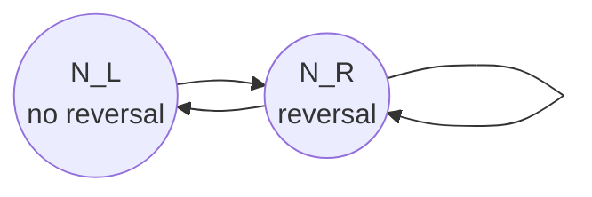
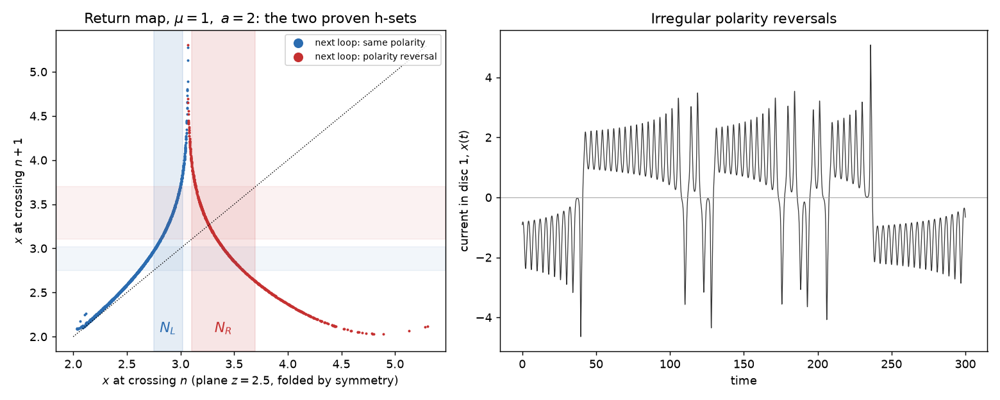

# Rikitake's dynamo is chaotic: a computer-assisted proof

**Two spinning copper discs, the simplest mechanical model of a planet's magnetic field flipping, have been called
chaotic since 1980. We proved it has chaotic motions for three settings: any flip pattern that never skips two flips in a row is followed
by an exact motion of the model.**

Moki & Julio (AI-assisted) · 2026 · DOI [10.5281/zenodo.23041182](https://doi.org/10.5281/zenodo.23041182) (concept
DOI, resolves to the latest version) · version 1.1 · text CC BY 4.0, code MIT

## The story in a minute

A planet's magnetic field can flip, north becoming south. In 1958 Tsuneji Rikitake proposed the simplest mechanical
model of such flipping: two spinning copper discs, each driving current through the other's coil. Three
equations describe it, and in simulations its polarity reverses at irregular, apparently random moments.

Since Ito's numerical study of 1980 the model has been called chaotic, and it is used as a stock chaotic system in
hundreds of papers. Its relatives have been proved chaotic: the Lorenz equations, and the Rössler equations (in 1997),
among others. As far as we could find, Rikitake's dynamo never was. This repository proves it for three parameter settings.

A picture that helps: **kneading dough.** A baker stretches the dough long, lays it back across itself and stretches
it again. Crumbs that start side by side can be sent along completely different routes. Here the "dough" is the set of possible states of the dynamo, and one
loop of its motion does the stretching. We picked two small, thin boxes of states: one whose next loop brings **no**
reversal, one whose next loop **does** reverse. We proved that one loop stretches each box right across the boxes it
leads to, overhanging both ends; the "reverse" box is stretched across both.

Once every link is proved, any route through the links is followed by a real motion. Where the picture breaks: a baker
mixes all the dough, but we prove the stretching only for these two thin boxes. The theorem says nothing about most
starting points, or about what a typical simulation settles into. The theorem says nothing about how fast nearby states separate (no Lyapunov exponents).

"Proved" here means this. Every calculation returns a range that is guaranteed to contain the true value, with every
rounding error counted. Two programs, written separately, check every case. Both pass all three, and both reject a
deliberately broken box. Version 1.1 fixed a slip in one bound shared by both programs, and made checker B run CAPD
in one process per strip (see below); the results did not change.

## Climb the ladder

### Step 1 - the idea (for anyone)

The dynamo has no outside push, so there is no strobe to sample it with. Instead we take a snapshot each time the third
variable z falls through a fixed value c. The rule that takes one snapshot to the next is the **return map** Q. Because
a field and its exact reverse behave alike, Q treats them as the same state and records only whether the polarity
flipped on the way.

The route map has two boxes: N_L (the next loop does **not** reverse) and N_R (the next loop **does**).



There is no arrow from N_L to itself. So the theorem reads: for **any** endless sequence of "reverse / don't reverse"
with no two "don't" in a row, there is an exact solution of the equations whose loops follow that sequence. Repeating
sequences give repeating motions, so there are infinitely many periodic orbits.

### Step 2 - how it works (for a curious student)

The equations are x' = -mu x + y z, y' = -mu y + (z - a) x, z' = 1 - x y. Polarity reverses when x and y change sign
together. The three proved settings are (mu, a) = (1, 2), (1, 3.75) and (2, 5), with snapshot levels c = 2.5, 4.0 and
5.8. The parameters mu and a are numbers in the equations that set how the discs and coils behave.

**A good ruler.** On the snapshot plane, the simulated motion lies close to a thin curve. We fit a fixed polynomial to
that curve once and measure each point by u (the x-coordinate along the curve) and s (the height above or below it). Each box is a stretch of
u with |s| below a small width w.

**A worked example, setting (1, 2).** N_L runs from u ≈ 2.74952 to 3.01882 and N_R from u ≈ 3.10618 to 3.69748, with
w = 0.01. Checker A proved where the edges of N_L land after one loop:

| edge of N_L | lands somewhere in | must land | holds? |
|---|---|---|---|
| left edge (u = l0) | [2.93428, 3.01536] | below the start of N_R (3.10618) | yes |
| right edge (u = l1) | [3.74415, 4.01580] | above the end of N_R (3.69748) | yes |

So the image of N_L reaches past both ends of N_R: N_L ⇒ N_R. The edges of N_R land above 3.69748 and below 2.74952, so
its image reaches across both boxes. Each check also needs the image to stay within |s| < w, and every loop to cross the
plane cleanly with the stated polarity outcome.

**How fast the patterns multiply.** Count the allowed patterns of three loops: of the 8 strings of R and N, five have no
"NN" (RRR, RRN, RNR, NRR, NRN). The counts follow the Fibonacci numbers, growing by the golden ratio (1+√5)/2 per loop.
That growth rate gives the **topological entropy**: at least log((1+√5)/2) ≈ 0.481 per return.

### Step 3 - the real thing (for specialists)

- **Theorem.** For (mu, a) ∈ {(1, 2), (1, 3.75), (2, 5)} (exact IEEE doubles in `proof/design_*.txt`), let Q be the
  first-return map of the Rikitake flow to z = c (c = 2.5, 4.0, 5.8; crossings with z decreasing), folded by the symmetry
  (x, y, z) -> (-x, -y, z). There are disjoint compact N_L, N_R in that plane with Q: N_L ⇒ N_R, N_R ⇒ N_L, N_R ⇒ N_R
  (Zgliczyński–Gidea covering relations); orbits through N_L return without a reversal, orbits through N_R with one.
- **Consequences.** Every pattern with no two consecutive non-reversals is realised; infinitely many periodic orbits; a
  compact invariant set on which Q is semi-conjugate to the golden-mean shift, so h_top ≥ log((1+√5)/2) ≈ 0.481 per
  return.
- **Checkers.** Checker A ([`proof/check.cpp`](proof/check.cpp), CAPD, order 20): 62,041 / 352,843 / 529,398 pieces,
  about 9 / 55 / 72 min on one core, all VERIFIED. Checker B ([`independent/`](independent/), a generic verifier written
  from [`independent/SPEC.md`](independent/SPEC.md) only): 44,166 / 164,809 / 323,590 pieces, all PASS, with an exact
  coverage audit (PASS).
- **Controls.** CAPD's proof of the Rössler horseshoe reproduces; a design with one edge moved is rejected by both.
- **Correction (v1.1).** Both v1.0 checkers evaluated one Lagrange remainder over the wrong interval (rigorous here
  only because the expansion point lies in the interval by construction). v1.0 checker B also ran several CAPD threads
  in one process, which CAPD does not guarantee to be safe; v1.1 uses one process per strip. Both fixed in v1.1; every
  result regenerated, nothing changed. Details below, in the original README.



## Use it as a tool

Questions this lets you answer:

- Does the proof check out on my machine, from the published files alone?
- Does the checker reject a box that is wrong?
- Can I check covering relations for a return map of **my own** three-variable system? Checker B is generic: it reads
  a plain `.spec` file (variables, parameters, vector field, section plane, chart polynomial, boxes) described in
  [`independent/SPEC.md`](independent/SPEC.md). The three Rikitake designs are written in that format. It checks the
  per-box conditions only (SPEC.md claims 1-3); disjointness of the boxes and the covering-relation theorem's other
  hypotheses remain your job.

**Re-run everything** (Linux or WSL, g++ ≥ 11, CMake, git, Python 3). About 3 hours in total; checker A is
single-threaded. On Windows, clone with `-c core.autocrlf=false` so the shell script keeps its Unix line endings.

```
git clone -c core.autocrlf=false https://github.com/Hashirama1337s/rikitake-chaos
cd rikitake-chaos
bash reproduce.sh
```

Each checker A run ends with `RESULT: ALL COVERING CONDITIONS VERIFIED` or `RESULT: NOT VERIFIED`; each checker B run
ends with `OVERALL=PASS` or `OVERALL=FAIL`, followed by its coverage audit. If you already have CAPD built at commit
`03dc5628203334b214bb7d9fd63788a175521005`, `CAPD_DIR=/path/to/capd bash reproduce.sh` skips the build.

**Quick check: one case in a few minutes** (checker B on setting (1, 2), then the broken design). With `CAPD` set to a
CAPD build at that commit:

```
cd independent
CF=$(sed -n 's/^Cflags: //p' "$CAPD/build/bin/capd.pc"); LB=$(sed -n 's/^Libs: //p' "$CAPD/build/bin/capd.pc")
g++ $CF -pthread verify_b_gen.cpp $LB -o verify_b_gen
python3 drive_b.py rikitake_published_mu1_a2_c2.5.spec pub_mu1_a2_c2.5 $(nproc)
tail -n 1 run_b_pub_mu1_a2_c2.5.log      # TOTAL leaves=44166 ... OVERALL=PASS
tail -n 1 audit_b_pub_mu1_a2_c2.5.log    # COVERAGE AUDIT: PASS
python3 drive_b.py negctrl/rikitake_NEG_r1_3.40.spec NEG_r1_3.40 $(nproc)
tail -n 1 run_b_NEG_r1_3.40.log          # TOTAL leaves=43264 ... OVERALL=FAIL, as required
```

This rewrites the shipped logs in `independent/`; run it in a fresh copy if you want to compare.

**Your own system.** Copy one of the `rikitake_published_*.spec` files, change the variables, parameters, vector field,
section and boxes, and run `drive_b.py` on it. Finding good boxes is the hard, non-rigorous part; the Python scripts in
[`design/`](design/) show how we fitted the chart and chose the sets for Rikitake.

## What we did not show

- That almost every orbit is chaotic, or that the attractor seen in simulations is exactly this invariant set.
- Anything at parameter values other than the three proved.
- Version 1.0 of both checkers shared a slip in one bound (the Lagrange remainder of the chart polynomial). It did not
  bite here, but as written the step was not rigorous in general. v1.1 fixes it, regenerates every result and records
  the slip in the "Correction (v1.1)" section below.
- Both checkers use the CAPD library (our note; the same limit is stated in the laser-chaos repository), so a bug
  inside CAPD would affect both. The v1.0 slip shows the same risk from another side: two independently written
  checkers can still share a mistake.
- v1.0 checker B ran several CAPD threads in one process, which CAPD does not guarantee to be safe; v1.1 runs one
  process per strip.

## Words you will meet

- **Return map** - the state recorded each time the motion passes through a fixed plane, and the rule from one such
  snapshot to the next.
- **Polarity reversal** - x and y changing sign together: the model's version of the field flipping.
- **Chaos (as proved here)** - a set of motions that can follow any pattern from a list of allowed patterns, with
  positive topological entropy.
- **Topological entropy** - how fast the number of distinguishable patterns grows per step, on a log scale.
- **Covering relation (N ⇒ M)** - one step stretches box N right across box M, past both ends, while staying inside
  M's width.
- **Golden-mean shift** - all endless strings of two symbols in which one symbol never appears twice in a row.
- **Interval arithmetic** - computing with ranges that are guaranteed to contain the true value, rounding included.
- **Periodic orbit** - a motion that repeats exactly.
- **Negative control** - a deliberately broken input that the checker must reject.
- **CAPD** - a C++ library for rigorous computation with differential equations.

---

## For specialists: the original README

# Rikitake's dynamo is chaotic: a computer-assisted proof

**Moki&Julio · 2026** · DOI [10.5281/zenodo.23041182](https://doi.org/10.5281/zenodo.23041182)

In 1958 Tsuneji Rikitake proposed the simplest mechanical model of a planet's magnetic field flipping: two
spinning copper discs, each driving current through the other's coil. Its three equations

```
x' = -mu x + y z
y' = -mu y + (z - a) x
z' = 1 - x y
```

produce irregular, apparently random polarity reversals (x and y change sign together). The model has been
called chaotic since Ito's numerical study (Earth Planet. Sci. Lett. 51, 1980) and is used as a stock chaotic
system in hundreds of papers, but, as far as we could find, **its chaos has never been proved**. Its relatives have
been: the Lorenz equations (Galias–Zgliczyński, Mischaikow–Mrozek, Tucker), the Rössler equations
(Zgliczyński 1997), Lorenz-84 and others. This repository closes that gap for three parameter values.


## Theorem

Let (mu, a) be one of **(1, 2)**, **(1, 3.75)** or **(2, 5)**. [^params] Let Q be the first-return map of the
Rikitake flow to the plane z = c (crossings with z decreasing; c = 2.5, 4.0 and 5.8 respectively), folded by the
symmetry (x, y, z) -> (-x, -y, z). There are two disjoint compact sets N_L and N_R in that plane such that

* every orbit through N_L returns **without** a polarity reversal, and every orbit through N_R returns **with** one;
* Q satisfies the covering relations N_L ⇒ N_R, N_R ⇒ N_L and N_R ⇒ N_R.

Consequently (Zgliczyński–Gidea, J. Differential Equations 202, 2004):

1. **Every reversal pattern that never has two non-reversal loops in a row is realised by a true solution.** For any
   sequence of "reverse / don't reverse" with no two consecutive "don't", there is an exact solution of the
   equations whose successive loops follow exactly that sequence.
2. Every periodic such pattern is realised by a periodic orbit, so there are infinitely many periodic orbits.
3. The return map has a compact invariant set on which it is semi-conjugate to the golden-mean shift, so its
   **topological entropy is at least log((1+√5)/2) ≈ 0.481 per return**.

This is chaos in the sense of positive topological entropy and symbolic dynamics on an invariant set, the same kind
of statement proved for Rössler and (first) for Lorenz. It does not say that almost every orbit is chaotic, nor
that the attractor seen in simulations is exactly this invariant set.

[^params]: Values are the exact IEEE doubles written in `proof/design_*.txt`. (1, 3.75) is the case K = 2 in the
Cook–Roberts parametrisation a = mu(K² − K⁻²); (2, 5) is a value common in the modern chaos-control literature.

## How it is proved

1. **A good chart.** On the plane z = c the attractor is a thin curve. A fixed polynomial p (degree 8) is fitted to
   it once, and points are written in the global coordinates (u, s) = (x, y − p(x)), a homeomorphism of the plane.
   N_L = [l0, l1] × [−w, w] and N_R = [r0, r1] × [−w, w] in these coordinates (w = 0.01; 0.003 for (2, 5)).
2. **Rigorous Poincaré maps.** With the CAPD library (validated Taylor integration, interval arithmetic, order 20),
   each set is covered by small pieces; for each piece CAPD returns a guaranteed enclosure of its image, computed in
   coordinates aligned with the curve to avoid wrapping. Pieces that fail are bisected automatically.
3. **The inequalities.** For every piece: the return is transversal, the polarity outcome is the stated one, and the
   image satisfies |s| < w. For the four edges u = l0, l1, r0, r1: the images land strictly beyond the target sets
   (u < r0, u > r1, u > r1, u < l0 respectively). These are exactly the conditions for the covering relations, with
   a straight-line homotopy to a linear map.

Everything that matters for correctness is in interval arithmetic; the polynomial fit, the choice of the sets and
the choice of which direction to bisect are heuristics that can only make the check fail, never pass falsely.

## Results

| (mu, a) | plane z = c | N_L = [l0, l1] (≈) | N_R = [r0, r1] (≈) | w | pieces (checker A) | time, 1 core (≈) | result |
|---|---|---|---|---|---|---|---|
| (1, 2) | 2.5 | [2.74952, 3.01882] | [3.10618, 3.69748] | 0.01 | 62,041 | 9 min | VERIFIED |
| (1, 3.75) | 4.0 | [3.18142, 3.46027] | [3.56336, 4.16186] | 0.01 | 352,843 | 55 min | VERIFIED |
| (2, 5) | 5.8 | [3.39240, 3.68512] | [3.75050, 4.75840] | 0.003 | 529,398 | 72 min | VERIFIED |

Proven edge images (checker A), each of which must land beyond the stated bound:

| (mu, a) | Q(l0-edge): u < r0 | Q(l1-edge): u > r1 | Q(r0-edge): u > r1 | Q(r1-edge): u < l0 |
|---|---|---|---|---|
| (1, 2) | [2.93428, 3.01536] | [3.74415, 4.01580] | [3.71240, 4.19544] | [2.61255, 2.64086] |
| (1, 3.75) | [3.34939, 3.51585] | [4.16603, 4.47436] | [4.30263, 4.89122] | [3.03380, 3.08344] |
| (2, 5) | [3.69174, 3.73788] | [4.76065, 4.94327] | [4.76524, 4.92351] | [3.35616, 3.36668] |

Edge-image bounds are rounded outward to 5 decimals from the logs in `proof/`; set endpoints (≈) are rounded for display, their exact values are in `proof/design_*.txt`.

Two independent programs were run on every case: **checker A** (`proof/check.cpp`) and **checker B**
(`independent/`, written independently from the mathematical specification `independent/SPEC.md` only, without access to
checker A). Both verify all three cases. Checker B is a generic covering-relation verifier that reads a `.spec` file; it runs
one single-threaded CAPD process per strip (`drive_b.py`), and its certified pieces are audited to tile each set and edge
exactly on the exact doubles (`independent/audit_b_pub_*.log`):

| (mu, a) | checker B pieces | wall time (6 cores) | result | coverage audit |
|---|---|---|---|---|
| (1, 2) | 44,166 | 2.1 min | PASS | PASS |
| (1, 3.75) | 164,809 | 6.7 min | PASS | PASS |
| (2, 5) | 323,590 | 18.7 min | PASS | PASS |

Controls: CAPD's own proof of the Rössler horseshoe (Zgliczyński 1997) reproduces (`reproduce.sh` builds it from the CAPD sources), and a
deliberately false design (one edge moved so its condition fails by a clear margin) is rejected by both checkers
(`proof/negctl.log`, `independent/negctrl/`).

## Correction (v1.1)

Version 1.0 of both checkers contained the same slip in one bound. The chart coordinate s = y − p(x) of an image point was
enclosed with a Taylor form of p about the centre of the image's x-interval; the Lagrange remainder term was evaluated with
p'' over the image interval X alone, where it must be evaluated over the hull of the expansion point and X. The two
intervals coincide in all but degenerate cases, and the enclosure is correct whenever the expansion point lies in X (as it
does here, by construction), but as written the step was not rigorous for an arbitrary expansion point. Version 1.1 fixes
the remainder (p'' over `hull(xh, X)`) and, in addition, intersects the Taylor enclosure with a direct evaluation
`(y − p(X))`, which is rigorous on its own; checker B was rewritten as the generic verifier above with the same fix. The
v1.0 checker B also ran several CAPD threads in one process, which CAPD does not guarantee to be safe; v1.1 uses one process
per strip. Every result in this README was regenerated from scratch with the corrected programs (`reproduce_full.log`);
the covering relations, the edge images to five decimals and the conclusions are unchanged. We record the slip here
because a computer-assisted proof is only as good as the published checker.

## Reproduce

Requires Linux (or WSL), g++ ≥ 11, CMake, git, Python 3. About 3 hours in total (checker A is single-threaded).

```
bash reproduce.sh
```

builds CAPD 6.1 at the pinned commit `03dc5628203334b214bb7d9fd63788a175521005`, compiles both checkers and runs
every case (the complete output of our own clean-room run of v1.1 is `reproduce_full.log`, 2 h 56 min on a 6-core machine,
CAPD build included). Each checker A run ends with `RESULT: ALL COVERING CONDITIONS VERIFIED` or `RESULT: NOT VERIFIED`;
each checker B run ends with `OVERALL=PASS` or `OVERALL=FAIL` followed by its coverage audit.

`design/` holds the (non-rigorous) Python scripts that fitted the chart and chose the sets, and the figure script.

## Prior work we checked

Searches (Crossref, web, 2026-09-27 and 2026-09-29) for Rikitake with horseshoe, topological horseshoe,
computer-assisted, interval arithmetic, rigorous and symbolic dynamics found numerical studies (Ito 1980;
Hoshi 1988; two-disc parametric studies 2024–2025), integrability and invariant-surface work, and many
control/synchronisation papers, but no proof of chaos. If you know of one, please open an issue and we will credit it
here.

## Licence and citation

Text and results CC-BY-4.0 (`LICENSE`); code MIT (`LICENSE-CODE`). CAPD is used under its own licence and is not
redistributed. Built with AI assistance. See `CITATION.cff`; cite as Moki&Julio (2026), *Rikitake's two-disc dynamo is chaotic: a computer-assisted proof*, version 1.1, Zenodo, doi:10.5281/zenodo.23041182 (concept DOI, resolves to the latest version).

## Other work by Moki & Julio

- [moki-julio-wifi-ris-cell](https://github.com/Hashirama1337s/moki-julio-wifi-ris-cell): One 1-bit reconfigurable-intelligent-surface cell covering the 2.4 GHz and 5-7 GHz Wi-Fi bands with one switch state (simulation study, Palace FEM) ([doi:10.5281/zenodo.23165406](https://doi.org/10.5281/zenodo.23165406))
- [szilassi-12](https://github.com/Hashirama1337s/szilassi-12): No symmetric 12-face Szilassi polyhedron: a computer-assisted proof with DRAT certificates ([doi:10.5281/zenodo.23003257](https://doi.org/10.5281/zenodo.23003257))
- [moki-julio-circle-packing](https://github.com/Hashirama1337s/moki-julio-circle-packing): 6,071 new best-known packings of equal circles, spheres and hyperspheres, each verified by two independent exact checkers ([doi:10.5281/zenodo.22981305](https://doi.org/10.5281/zenodo.22981305))
- [kinect-v1-depth-levels](https://github.com/Hashirama1337s/kinect-v1-depth-levels): The Xbox 360 Kinect measured as an instrument: the depth lattice, three noise populations, drift and a capability map

All projects: [github.com/Hashirama1337s](https://github.com/Hashirama1337s)
